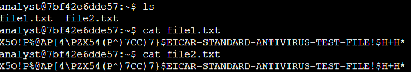
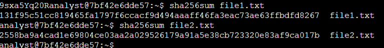
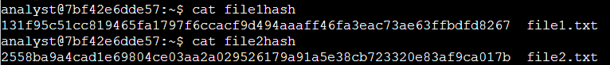
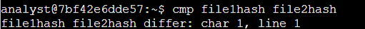

# Lab: Comparing Files with Hashes

---

## Scenario Overview

This lab investigates whether two files are genuinely identical or different. The process has two stages: displaying the contents of each file and generating a hash for each, then examining and comparing those hashes. The session begins with the **analyst** account already logged in to the Bash shell, in the home directory `/home/analyst`.

---

## Task 1: Generate Hashes for Files

The home directory contains `file1.txt` and `file2.txt`, which are reported to hold the same data. The first step is to list the directory contents.

```bash
ls
```

Output:

```text
file1.txt  file2.txt
```


Both files are then displayed using `cat`. If a command is entered incorrectly and fails to return to the prompt, `CTRL+C` can be used to stop the process and force the shell back to the command line.

```bash
cat file1.txt
cat file2.txt
```

Output:

```text
analyst@4fb6d613b6b0:~$ cat file1.txt
X5O!P%@AP[4\PZX54(P^)7CC)7}$EICAR-STANDARD-ANTIVIRUS-TEST-FILE!$H+H*
analyst@4fb6d613b6b0:~$ cat file2.txt
X5O!P%@AP[4\PZX54(P^)7CC)7}$EICAR-STANDARD-ANTIVIRUS-TEST-FILE!$H+H*
```

**Do the contents of the two files appear identical when using `cat`?**

Yes. The displayed contents appear identical for both files.

Visual inspection is not proof, however. A hash must be generated for each file to determine whether the files are actually different.

```bash
sha256sum file1.txt
sha256sum file2.txt
```

Output:



```text
analyst@4fb6d613b6b0:~$ sha256sum file1.txt
131f95c51cc819465fa1797f6ccacf9d494aaaff46fa3eac73ae63ffbdfd8267  file1.txt
analyst@4fb6d613b6b0:~$ sha256sum file2.txt
2558ba9a4cad1e69804ce03aa2a029526179a91a5e38cb723320e83af9ca017b  file2.txt
```

**Do both files produce the same generated hash value?**

No. The two hashes differ, which indicates that the file contents are not identical.

---

## Task 2: Compare Hashes

Rather than comparing values on screen, each hash is written to its own file so the two can be compared directly.

```bash
sha256sum file1.txt >> file1hash
sha256sum file2.txt >> file2hash
```

Two hashes now exist in separate files — `file1hash` and `file2hash` — and can be displayed for manual inspection.

```bash
cat file1hash
cat file2hash
```


The output confirms that the hashes written to the two files are completely different, even though the file contents previously appeared identical.

The `cmp` command then compares the two files byte by byte. If a difference is found, it reports the byte and line number where the first difference occurs.

```bash
cmp file1hash file2hash
```

Output:



```text
analyst@4fb6d613b6b0:~$ cmp file1hash file2hash
file1hash file2hash differ: char1, line 1
```

The output indicates that the hashes differ at the very first character of the first line.

**Based on the hash values, is `file1.txt` different from `file2.txt`?**

Yes. The contents of the two files are different, because their hash values differ.

---

## Conclusion

This lab provided practice with computing hashes using `sha256sum`, displaying hashes with `cat`, and comparing them using `cmp`. These are valuable tools for validating data integrity and contributing to an organization's overall security control.
